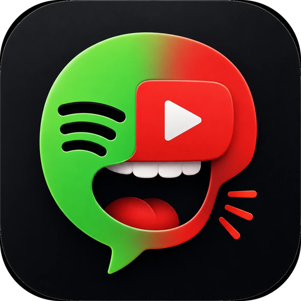

<p align="center">
  
</p>

<h1 align="center">X Assistant</h1>

<p align="center">A push-to-talk voice assistant for Windows that plays songs on YouTube or Spotify - without ever pulling you out of your game.</p>

---

## What it does

Press **F9**, say a song - *"play God's Plan by Drake"* / *"תנגן נזכרה בי"* - and it plays.

- **YouTube or Spotify**, picked with the toggle in the window.
- **Spoken confirmation** in a natural female voice: *"Gotchu, God's Plan is now playing on YouTube."* (English or Hebrew).
- **Never steals focus**: the song window opens on your second monitor, focus goes straight back to your game.
- **Song-only volume** bar and voice commands - never touches the Windows master volume.
- **Auto-close**: the YouTube song window closes itself when the song really ends.
- **No YouTube Shorts**, only normal videos.
- **Liquid-glass UI** (real Windows acrylic blur), black & purple, rounded everything.

## Voice commands

| Say | Does |
|---|---|
| "play Starboy", "תנגן סטארבוי" | Plays the song on the selected platform |
| "change song volume to 40", "שנה את עוצמת השיר לארבעים" | Song volume |
| "volume up / down", "mute / unmute the music" | Volume steps / mute |
| "pause", "resume", "next" | Playback control |
| "loop", "לופ" / "stop the loop", "בטל לופ" | Repeat the current song |

The ⌨ button lets you type commands instead of speaking.

## Download

Grab **XAssistant.exe** from the [Releases](../../releases) page and run it.
On first run Windows SmartScreen may warn about an unsigned app: *More info → Run anyway*.

Then open **⚙ Settings** to pick your microphone and run **Mic check**, and use **Sign in to YouTube** once so songs play on your own account.

## How it works (short)

- **Speech** → Google speech recognition (English / Hebrew).
- **YouTube** → a dedicated Chrome window controlled over the local DevTools protocol (same tab, volume, loop, end-of-song detection), placed on the secondary monitor without activation.
- **Spotify** → Spotify Free can't be started via the Web API, so the desktop app is driven through Windows UI Automation (accessibility interface); Premium + API keys are used when available.
- **Voice** → ElevenLabs if a key is set, otherwise Microsoft's neural *Emma Multilingual* voice.

## Build from source

```bash
python -m venv .venv
.venv\Scripts\pip install -r requirements.txt
.venv\Scripts\pyinstaller --onefile --noconsole --name XAssistant --icon icon.ico --add-data "icon.ico;." --hidden-import websocket --hidden-import pycaw.pycaw --hidden-import comtypes.stream --collect-submodules comtypes --collect-all uiautomation --collect-all edge_tts --collect-data certifi --hidden-import psutil x_assistant.py
```

Windows 10/11 only (Windows 11 for rounded corners).

---

## © Copyright

**© 2026 zush / maoz. All rights reserved.**

The software, source code, design, the name "X Assistant" and the icon are the property of zush / maoz.
No part of it may be copied, reproduced, modified, distributed, sold or used commercially without prior written permission.
See [LICENSE](LICENSE).

**© 2026 zush / maoz. כל הזכויות שמורות.** אין להעתיק, לשכפל, להפיץ, למכור, לשנות או לעשות שימוש מסחרי בכל חלק מהתוכנה ללא אישור מראש ובכתב.

<p align="center"><i>made by zush / maoz</i></p>
